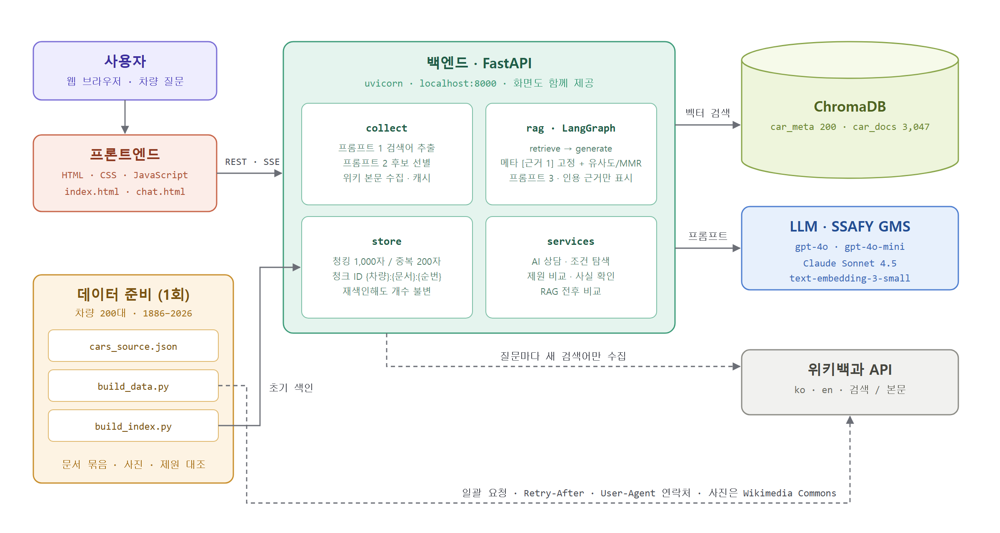

# 🚗 MOTORLAB

**1886년 벤츠 파텐트 모토르바겐부터 2026년형 전기차까지, 모든 자동차 질문에 문서 근거와 함께 답하는 RAG 기반 자동차 지식 서비스**

엔진·변속기·출력·토크·구동방식·연비·전장/전폭/전고·휠베이스·제로백·서스펜션·승차감을 물으면, 차량 메타데이터와 위키백과 문서에서 근거를 찾아 답하고 답변의 문장마다 **[근거 n]** 번호와 원문 출처를 붙입니다. 문서에서 확인되지 않는 내용은 추측하지 않고 "확인되지 않습니다"라고 답합니다.

- **규모**: 차량 200대 · 수집 문서 345건 · 색인 청크 3,047개 · 차량 사진 200장
- **실행**: 로컬 (`uvicorn backend.server:app` → http://localhost:8000)

---

## 아키텍처



## 왜 만들었나

LLM에게 자동차 제원을 물으면 그럴듯하지만 틀린 숫자가 자주 나옵니다. 같은 모델이라도 연식·트림·시장마다 출력과 치수가 다르고, 오래된 차일수록 정보가 흩어져 있기 때문입니다. 실제로 근거 없이 "1세대 테슬라 로드스터의 출시 가격"을 물으면 모델은 출처 없이 금액을 단정하지만, MOTORLAB은 색인된 문서에 가격 정보가 없으므로 "제공된 문서에서 확인되지 않습니다"라고 답합니다.

MOTORLAB은 **답변의 모든 사실을 검색된 문서로 뒷받침하고, 그 문서를 사용자가 직접 확인할 수 있게** 만드는 것을 목표로 했습니다.

## 핵심 기능

**AI 상담 (근거 기반 질의응답)**

- 차량을 고르고 채팅으로 질문 — 차량별 대화 기록 유지, 두 페이지(메인 Q&A 탭 · AI 상담 전용 페이지) 간 대화 이어가기
- 검색어 추출 → 후보 선별 → 문서 수집 → 근거 검색 → 답변 생성 **5단계 진행 상황을 실시간 스트리밍(SSE)** 으로 표시
- 답변 본문의 [근거 n]을 누르면 해당 근거로 이동, **실제로 인용된 근거만** 제목·원문 링크·출처 종류(메타데이터 / 위키백과 KO·EN)와 함께 표시
- 답변 모델 선택: **GPT-4o · GPT-4o mini · Claude Sonnet 4.5**

**조건 기반 차량 탐색**

- "1990년 이전의 후륜구동 수동 스포츠카", "주행거리 700km 이상 전기차"처럼 자연어로 조건 입력
- 메타데이터 색인에서 후보 20대를 찾은 뒤 LLM이 조건을 모두 만족하는 차량만 골라 이유와 함께 카드로 제시

**도메인 특화 기능**

- **제원 비교**: 최대 3대를 나란히 비교하는 표 + 메타데이터만 근거로 쓴 AI 비교 요약
- **사실 확인**: "아우디 콰트로는 5기통 터보 엔진을 얹은 사륜구동 차다" 같은 주장을 문서 근거로 사실 / 사실 아님 / 확인 불가 판정

**검색 설정 실험 (화면에서 바로 비교)**

- Top-k, 유사도 검색 ↔ **MMR** 전환, 검색됐지만 인용되지 않은 근거까지 보기
- **RAG 전후 비교**: 같은 질문을 근거 없이 받은 답과 나란히 표시

## 동작 흐름

```
사용자가 차량을 고르고 질문
        ↓
프롬프트 1 (GPT-4o mini) — 질문에 필요한 위키백과 검색어 추출 (JSON 배열)
        ↓ 이미 수집한 (차량, 검색어)는 건너뜀
위키백과 검색 → 프롬프트 2 — 본문을 받기 전에 제목·요약만 보고 색인할 문서 선별
        ↓
선별 문서만 본문 수집 → 청킹 → ChromaDB car_docs 컬렉션에 색인
        ↓
LangGraph retrieve — 선택 차량의 메타데이터 청크를 [근거 1]로 고정
                    + car_docs를 차량 ID로 좁혀 유사도/MMR 검색 → 병합 · 중복 제거
        ↓
LangGraph generate — 프롬프트 3: 근거만 사용, 문장마다 [근거 n], 없으면 "확인되지 않습니다"
        ↓
본문에서 인용 번호를 추출해 실제로 인용된 근거만 화면에 표시
```

## RAG 설계

| 항목 | 설계 | 이유 |
| --- | --- | --- |
| 컬렉션 | `car_meta`(차량 1대 = 청크 1개) / `car_docs`(외부 문서 청크) 분리 | 선택한 차량의 제원은 검색 없이 항상 근거에 넣고, 외부 문서만 의미 검색하기 위해 |
| 항목 텍스트 | 이름·연도·제조사·트림·차종·동력원·엔진·변속기·구동·출력·토크·가속·연비·치수·서스펜션·승차감을 한 텍스트로 | "제로백 4초 이하 전기차"처럼 제원 조건으로도 차량이 검색되도록 |
| 청크 ID | `{차량 ID}:{문서 ID}:{순번}` | 여러 차량이 같은 문서를 수집해도 서로 덮어쓰지 않도록. 재색인해도 개수 불변 |
| 청킹 | 1,000자 / 중복 200자, 위키 섹션 경계 우선 | 제원·역사 서술이 한 청크 안에서 끊기지 않는 크기 |
| 검색 | 차량 ID 필터 + 유사도 또는 MMR(후보 20 → Top-k) | 다른 차량 문서가 근거에 섞이지 않고, 겹치는 청크가 근거에 몰리지 않도록 |
| 프롬프트 3 | 근거 외 정보 금지 · 문장별 인용 · 트림 명시 · 없는 번호 삭제 | 근거 없는 수치와 지어낸 인용을 막기 위해 |

## 기술 스택

| 영역 | 스택 |
| --- | --- |
| 프론트엔드 | HTML · CSS · JavaScript (프레임워크 없음), SSE 스트리밍 수신 |
| 백엔드 | FastAPI · uvicorn, LangChain 1.3 · LangGraph 1.2 |
| 벡터 DB | ChromaDB 1.5 (컬렉션 2개, cosine) |
| LLM | SSAFY GMS 경유 — GPT-4o(답변) · GPT-4o mini(프롬프트 1·2) · Claude Sonnet 4.5(선택) · text-embedding-3-small |
| 외부 문서 | 한국어·영어 위키백과 API (실시간 수집 + 캐시), 선택적으로 PDF(pypdf) |
| 데이터 준비 | Python 스크립트 — 위키 문서 묶음·사진 일괄 수집, 인포박스 치수 대조, ChromaDB 색인 |

## 트러블슈팅

**1. 색인은 성공하는데 서버에서 열면 "hnsw index 로드 실패"**

차량이 42대일 때는 문제가 없다가 200대로 늘리자 재현됐습니다. 테스트 데이터 2,500개로 비교해 보니 **프로젝트 경로에 한글이 있으면 ChromaDB가 HNSW 인덱스 파일을 다시 읽지 못했고**, 영문 경로에서는 정상이었습니다. 청크가 약 1,000개를 넘어 HNSW 파일이 디스크에 따로 쓰이기 시작할 때만 드러나는 문제였습니다. 경로에 비ASCII 문자가 있으면 DB를 자동으로 영문 경로(`~/.motorlab/chroma`)에 두도록 설정을 바꿔 해결했습니다.

**2. 위키백과 요청이 한 번에 50초씩 막힘 (HTTP 429)**

차량마다 4~6번씩 요청을 보내다 보니 속도 제한에 걸렸습니다. 문서 확인·한국어 문서 연결·인포박스·사진 정보를 **최대 40대씩 묶어 한 번에 요청**하고, `Retry-After`를 따르는 재시도와 연락처를 넣은 User-Agent를 적용했습니다. 158대 추가 수집 때 일괄 조회는 38초, 본문 수집은 차량당 1~2초였고 429 대기는 한 번도 없었습니다.

**3. "어떤 역사를 가진 차야?"에 "확인되지 않습니다"라고 답함**

질문에 차 이름이 없어서, 함께 수집된 일반 문서("자동차")가 차량 자체 문서를 검색 결과에서 밀어냈습니다. 검색 질의에 차량 이름을 붙이고, 프롬프트 1·2에 지나치게 일반적인 문서를 고르지 않도록 규칙을 추가했습니다. 같은 질문에 포드 모델 T의 생산 시작일·판매 대수·가격 변화를 근거 5건과 함께 답하게 됐습니다.

**4. 위키백과 대표 사진이 다른 세대의 차**

모델 전체를 다루는 문서는 대표 사진이 최신 세대인 경우가 많았습니다(예: BMW M3 E30 문서에 현행 M3 사진). 200장을 직접 검수해 원래 세대가 중요한 차량은 Wikimedia Commons에서 맞는 사진 파일을 지정하고, 나머지는 데이터를 사진의 세대에 맞췄습니다. 제원도 영문 위키 인포박스 치수와 자동 대조해 차이가 나는 값을 보고서로 남겼습니다.

## 데이터 출처와 이용 조건

- **차량 제원**: 제조사 공개 자료와 위키백과를 참고해 직접 정리 (트림 기준, 연식·시장별로 다를 수 있음). 비어 있던 치수·중량은 영문 위키백과 인포박스 값으로 채우고 기록
- **위키백과 본문**: CC BY-SA 4.0 — 청크마다 원문 URL을 저장하고 화면에 원문 링크 표시
- **차량 사진**: Wikimedia Commons — 사진마다 저작자와 라이선스를 화면에 표기
